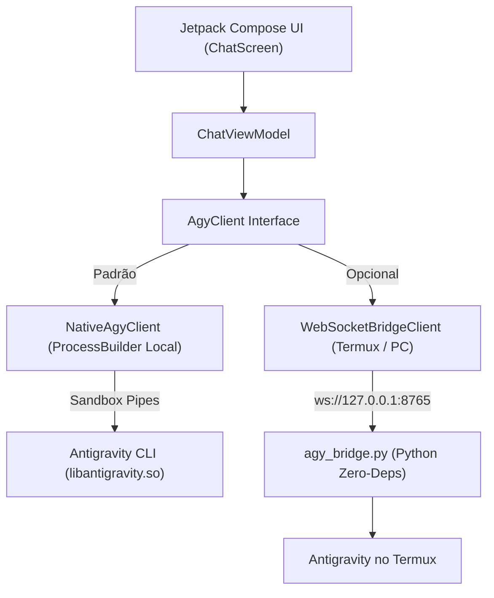

# Antigravity Android

Aplicativo Android nativo em **Jetpack Compose (Material 3)** que fornece uma interface gráfica moderna, fluida e eficiente para o **Antigravity CLI**.

---

## 🎯 Por que o Antigravity Android?

Interagir com ferramentas de IA avançadas e agentes autônomos em terminais móveis (como o Termux) apresenta diversos desafios de usabilidade:
- Falta de formatação rica e quebras de linha irregulares;
- Códigos ANSI e sequências de escape visíveis poluindo a tela;
- Dificuldade para ler, selecionar e copiar blocos de código em telas sensíveis ao toque;
- Ausência de controle visual de fluxo de trabalho.

O **Antigravity Android** resolve isso fornecendo uma experiência completa de chat com streaming token a token, renderização em tempo real de Markdown, botões contextuais de interrupção imediata (`SIGINT`) e suporte duplo de execução: **Nativo Standalone** ou **Remoto via Termux**.

---

## 🚀 Modos de Operação



### 1. Modo Nativo Standalone (Padrão)
- **100% autônomo:** Executa o binário do Antigravity CLI diretamente na sandbox do Android.
- **Zero Termux e Zero Python:** Não requer nenhum aplicativo externo nem servidor WebSocket em loopback.
- **Permissão de Execução Segura:** O binário nativo para ARM64 é empacotado como `libantigravity.so` em `jniLibs/arm64-v8a/`, sendo instalado com permissões legítimas de execução pelo Android (`nativeLibraryDir`).
- **Workspace Interno Isolado:** Projetos gerenciados em `context.filesDir/workspace` (ou em diretório externo configurável).

### 2. Modo Remoto Termux / PC (Opcional)
- Conecta-se a um servidor WebSocket RFC 6455 rodando no Termux ou em outro computador na rede local (`ws://127.0.0.1:8765`).
- O script `termux-bridge/agy_bridge.py` utiliza exclusivamente a biblioteca padrão do Python (**zero dependências externas via pip**).

---

## ✨ Funcionalidades

- **Streaming em Tempo Real:** Acompanhe a geração da resposta do agente token a token com animação de digitação pulsante.
- **Renderizador de Markdown:** Títulos, marcadores, listas ordenadas, links e blocos de código formatados com botão de cópia de 1 toque.
- **Controle de Interrupção (`SIGINT`):** Botão contextual dinâmico que alterna entre **Enviar** (quando ocioso) e **Parar** (quando o processo estiver trabalhando).
- **Sanitização Inteligente de ANSI:** Remove artefatos de terminal, sequências CSI e caracteres de retorno de carro (`\r`) de spinners, mantendo a tela limpa.
- **Console do Terminal:** Modal integrado para visualizar e inspecionar os logs brutos e saídas de diagnóstico sem formatação.
- **Gerenciador de Workspace:** Configure e aponte para qualquer diretório de trabalho suportado pelo dispositivo.

---

## 🏗️ Estrutura do Código

```
Antigravity Android/
├── app/
│   ├── src/main/
│   │   ├── AndroidManifest.xml
│   │   ├── jniLibs/arm64-v8a/          # Diretório para o binário libantigravity.so
│   │   └── java/com/example/antigravity/
│   │       ├── MainActivity.kt         # Activity principal com suporte Edge-to-Edge
│   │       ├── Navigation.kt           # Navegação raiz com Navigation3
│   │       ├── data/
│   │       │   ├── client/             # Interface AgyClient, NativeAgyClient, ProcessRunner e Factory
│   │       │   ├── model/              # Estados de conexão, DTOs e mensagens do chat
│   │       │   ├── network/            # WebSocketBridgeClient e AnsiCleaner
│   │       │   ├── settings/           # SettingsRepository e enum ClientMode
│   │       │   └── workspace/          # WorkspaceManager (diretórios padrão e customizados)
│   │       ├── ui/chat/                # ChatScreen, ChatViewModel e componentes Material 3
│   │       └── theme/                  # Definições de cores e tipografia Material Design
│   └── src/test/java/                  # Suíte completa de testes unitários (JVM)
├── termux-bridge/
│   ├── agy_bridge.py                   # Ponte WebSocket zero-deps em Python
│   └── README.md                       # Guia de instalação no Termux
├── docs/superpowers/
│   ├── specs/                          # Especificações técnicas de arquitetura
│   └── plans/                          # Planos de implementação detalhados
├── AGENTS.md                           # Instruções técnicas para agentes autônomos
└── CLAUDE.md                           # Guia de contexto do projeto
```

---

## 🔨 Compilação e Instalação

### Requisitos de Desenvolvimento
- **JDK:** 17 ou 21 (OpenJDK / Android Studio JBR)
- **Android SDK:** Compile SDK 36, Min SDK 24 (Android 7.0+)
- **Gradle:** 9.1.0 (incluso via `gradlew.bat`)

### Comandos de Build
```powershell
# 1. Executar testes unitários
.\gradlew.bat testDebugUnitTest

# 2. Compilar o APK de Debug
.\gradlew.bat assembleDebug

# 3. Localização do APK gerado
# app/build/outputs/apk/debug/app-debug.apk

# 4. Instalar no celular ou emulador conectado via USB (ADB)
adb install -r app/build/outputs/apk/debug/app-debug.apk
```

---

## 📱 Como Usar no Dispositivo

### Usando o Modo Nativo Standalone
1. Copie o binário compilado do **Antigravity CLI** para `app/src/main/jniLibs/arm64-v8a/libantigravity.so`.
2. Compile e instale o APK no seu aparelho Android (ARM64).
3. Abra o app — ele iniciará automaticamente o motor local dentro da sua sandbox!

### Usando o Modo Remoto com Termux
1. No Termux do celular:
   ```bash
   pkg update && pkg install python -y
   python agy_bridge.py
   ```
2. Abra o app **Antigravity Android**.
3. Toque no ícone de engrenagem ⚙️ no topo da tela, mude para o modo **Remoto WebSocket** e confirme o endereço `ws://127.0.0.1:8765`.
4. O status mudará para verde ("Conectado ao Termux").
